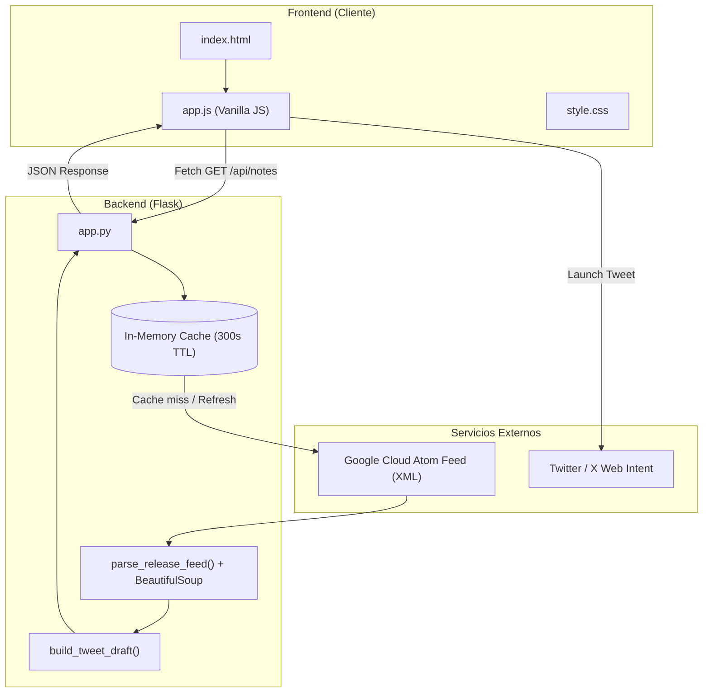

# BigQuery Release Notes Viewer & Tweet Sharer 🚀

[](https://www.python.org/)
[](https://flask.palletsprojects.com/)
[](https://opensource.org/licenses/MIT)
[](https://github.com/geaf-mr/Guille-event-talks-app)

Aplicación web desarrollada con **Python Flask** y **Vanilla JavaScript (HTML5/CSS3)** que consume, descompone, organiza y permite compartir en **X (Twitter)** las notas de lanzamiento oficiales de Google Cloud BigQuery en tiempo real.

---

## 🌟 Características Principales

* **📡 Feed Oficial en Tiempo Real**: Consume directamente el feed Atom oficial de Google Cloud:
  `https://docs.cloud.google.com/feeds/bigquery-release-notes.xml`.
* **🧩 Descomposición Granular de Actualizaciones**: Desglosa las notas diarias en tarjetas independientes clasificadas por categoría (`Feature`, `Change`, `Fixed`, `Announcement`, `Security`, etc.) a través de BeautifulSoup.
* **⚡ Caché en Memoria Inteligente (TTL 5 min)**: Minimiza la latencia y evita sobrecargar el servidor de Google con un sistema de caché en memoria de 300 segundos, incluyendo mecanismo de contingencia (*fallback*) ante desconexiones.
* **🔄 Recarga Forzada con Spinner**: Botón **"Refresh Notes"** que omite la caché bajo demanda (`/api/notes?refresh=1`) con animación de carga en vivo.
* **🐦 Generador y Publicador en X (Twitter)**:
  * Genera borradores automáticos optimizados dentro del límite de 280 caracteres.
  * Incluye enlaces directos a la documentación oficial y hashtags temáticos (`#BigQuery #GoogleCloud #DataEngineering`).
  * Integración con **Twitter Web Intent** para redactar y publicar sin requerir API keys de Twitter.
  * Contador interactivo de caracteres con avisos visuales.
  * Botón para copiar el texto al portapapeles con confirmación visual (Toast).
* **🔍 Búsqueda y Filtros Dinámicos**:
  * Búsqueda instantánea en el navegador por palabras clave (ej. *Gemini, Partition, SQL*).
  * Filtros por etiquetas de categoría con recuentos en tiempo real.
* **🎨 Cero Dependencias Frontend**: Interfaz moderna, responsive y ligera sin frameworks pesados, con diseño inspirado en Google Cloud.

---

## 🏗️ Arquitectura del Sistema



---

## 📁 Estructura del Proyecto

```text
Guille-event-talks-app/
├── app.py                 # Servidor Flask, lógica de caché, parseo XML/HTML y API REST
├── requirements.txt       # Dependencias de Python (Flask, requests, beautifulsoup4)
├── test_app.py            # Suite de pruebas unitarias (unittest)
├── README.md              # Documentación del proyecto
├── .gitignore             # Configuración de archivos ignorados por Git
├── templates/
│   └── index.html         # Plantilla base HTML5 con modal y barra de selección
└── static/
    ├── css/
    │   └── style.css      # Estilos CSS responsive basados en la identidad de Google Cloud
    └── js/
        └── app.js         # Lógica cliente: consumo de API, filtros, renderizado y modal
```

---

## 🚀 Instalación y Puesta en Marcha

### 1. Requisitos Previos
* **Python 3.8** o superior instalado en el sistema.
* Gestor de paquetes `pip`.

### 2. Clonar el Repositorio
```bash
git clone https://github.com/geaf-mr/Guille-event-talks-app.git
cd Guille-event-talks-app
```

### 3. Crear y Activar Entorno Virtual (Opcional pero recomendado)
* **En Windows (PowerShell)**:
  ```powershell
  python -m venv .venv
  .venv\Scripts\Activate.ps1
  ```
* **En macOS / Linux**:
  ```bash
  python3 -m venv .venv
  source .venv/bin/activate
  ```

### 4. Instalar Dependencias
```bash
pip install -r requirements.txt
```

### 5. Iniciar la Aplicación
```bash
python app.py
```

La aplicación se iniciará en modo desarrollo en:
```text
http://127.0.0.1:5000
```

---

## 🧪 Pruebas Unitarias

El proyecto incluye un conjunto de pruebas automatizadas con `unittest` que validan la entrega de la página principal y el correcto funcionamiento del endpoint de la API:

```bash
python test_app.py
```

Salida esperada:
```text
Ran 3 tests in ~1.0s
OK
```

---

## 🔌 Especificación de la API

### `GET /api/notes`
Obtiene la lista procesada de actualizaciones de BigQuery.

#### Parámetros de consulta (Query Params):
| Parámetro | Tipo | Descripción | Por defecto |
| :--- | :--- | :--- | :--- |
| `refresh` | `string` / `boolean` | Si es `1`, `true` o `True`, fuerza una petición directa a Google Cloud ignorando la caché. | `0` |

#### Ejemplo de Respuesta:
```json
{
  "success": true,
  "data": {
    "title": "BigQuery release notes",
    "feed_url": "https://docs.cloud.google.com/feeds/bigquery-release-notes.xml",
    "from_cache": false,
    "fetched_at": "2026-10-11 18:30:00",
    "total_entries": 15,
    "total_updates": 42,
    "categories": ["Announcement", "Change", "Feature", "Fixed", "Security"],
    "category_counts": {
      "Feature": 24,
      "Change": 11,
      "Fixed": 7
    },
    "updates": [
      {
        "id": "upd-0-0",
        "date": "October 08, 2026",
        "category": "Feature",
        "plain_text": "BigQuery now supports enhanced vector search...",
        "content_html": "<p>BigQuery now supports enhanced vector search...</p>",
        "link": "https://docs.cloud.google.com/bigquery/docs/release-notes#October_08_2026",
        "tweet_draft": "🚀 BigQuery [FEATURE] (October 08, 2026):\nBigQuery now supports enhanced vector search...\n\n🔗 https://docs.cloud.google.com/...\n#BigQuery #GoogleCloud #DataEngineering"
      }
    ]
  }
}
```

---

## 📄 Licencia

Este proyecto está bajo la licencia MIT. Consulta el archivo de licencia para más detalles.
